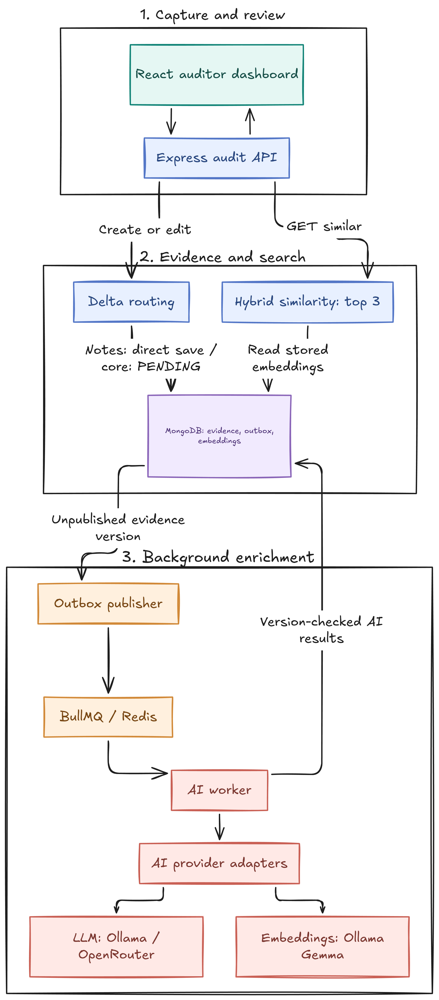
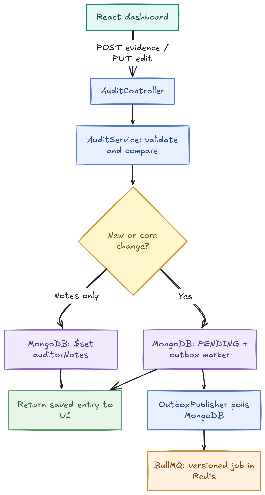
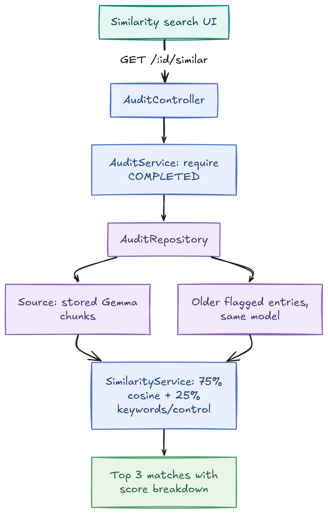
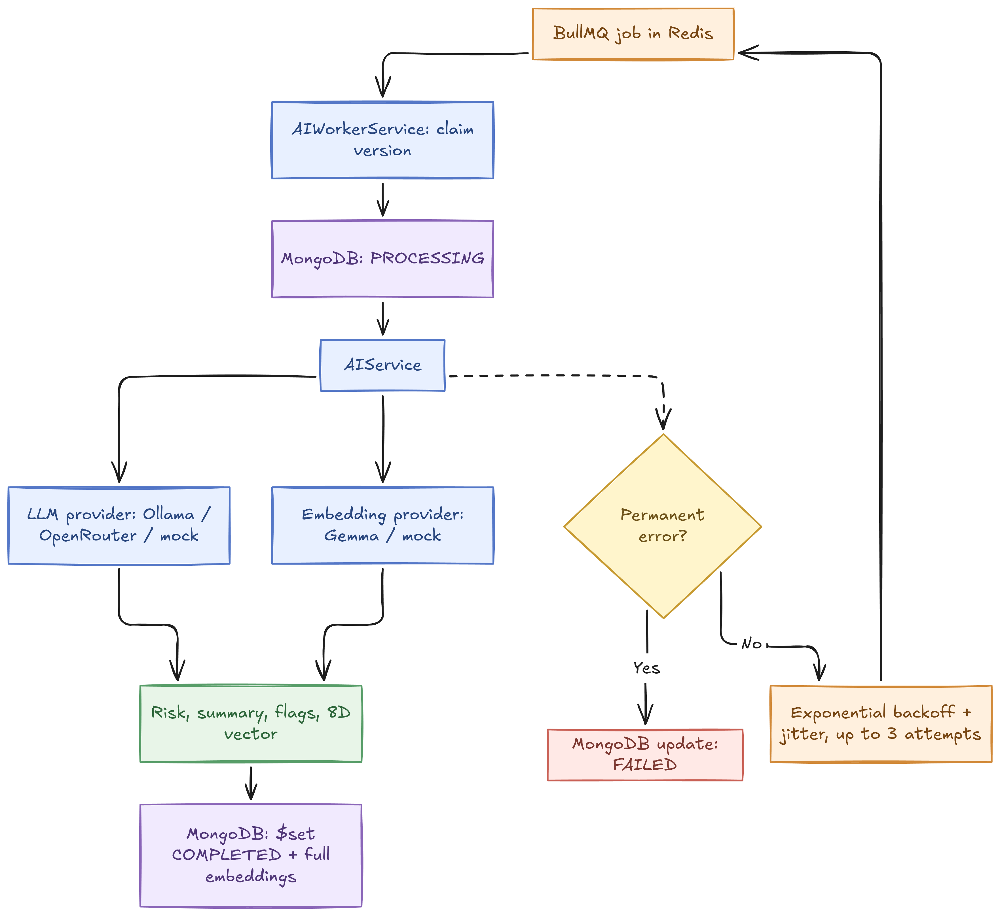

# Audit Pipeline

The TypeScript API and React dashboard save audit evidence immediately and queue relevant records for background risk enrichment. Auditor note edits take the direct save path; changes to core evidence queue fresh enrichment.

## High-level design



## Low-level flows

### 1. Evidence capture and queueing

A new record or core edit becomes `PENDING` in MongoDB. The outbox publisher queues it independently of the API response; a note-only edit saves directly.



### 2. Similarity search



### 3. Queue and AI enrichment

The worker claims one evidence version, runs both AI adapters, and saves results only while that claim is current. Transient failures retry with jitter; permanent provider errors fail immediately.



## Repository layout

```text
apps/
  api/             Express API and background worker
    src/
      controllers/ HTTP request handling
      repositories/ MongoDB access
      services/     Audit rules and AI boundary
      workers/      BullMQ background processor
  web/             React dashboard
```

## Local setup

See [local setup](docs/local-setup.md)