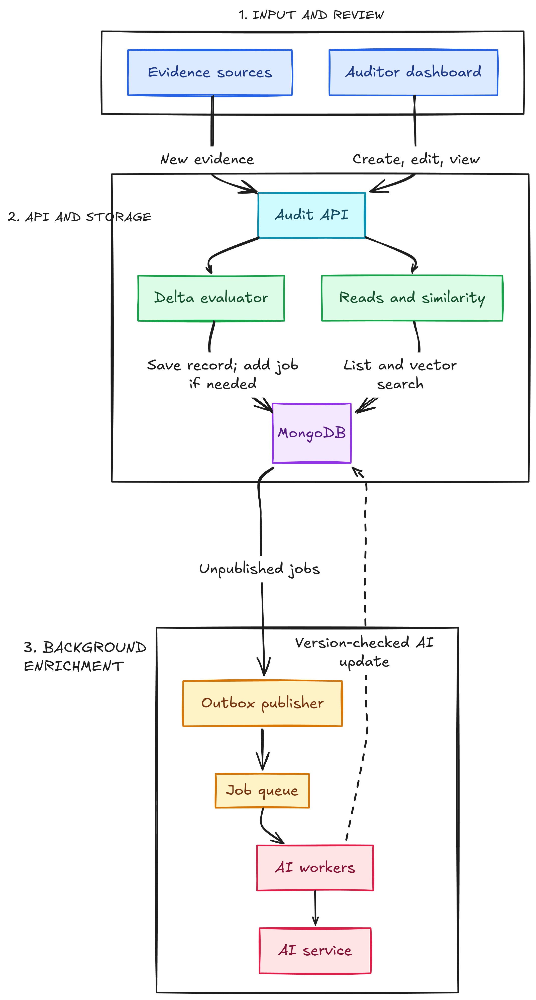

# Audit Pipeline

The TypeScript API and React dashboard save audit evidence immediately and queue relevant records for background risk enrichment. Auditor note edits take the direct save path; changes to core evidence queue fresh enrichment.

## High-level design



The design separates fast evidence capture from slower AI processing. A Mongo outbox publishes work to Redis, and separate workers enrich each evidence version.

## Modules

1. **Input and review:** Create evidence, edit notes or core fields, inspect records, and request similar historical exceptions in the dashboard.
2. **API and storage:** Validate requests, use targeted MongoDB updates, and atomically mark records for enrichment when core evidence changes.
3. **Background enrichment:** BullMQ workers call a swappable Ollama, OpenRouter, or mock provider and write version-checked AI results.

## Repository layout

```text
apps/
  api/             Express API and background worker
    src/
      controllers/ HTTP request handling
      repositories/ MongoDB access
      services/     Audit rules and AI boundary
      workers/      BullMQ background processor
  web/             React dashboard
```

## Local setup

See [local setup](docs/local-setup.md) and [enrichment flow](docs/enrichment-pipeline.md).

Seed data includes completed historical examples for similarity search. New records move from `PENDING` to `COMPLETED` through the worker.
